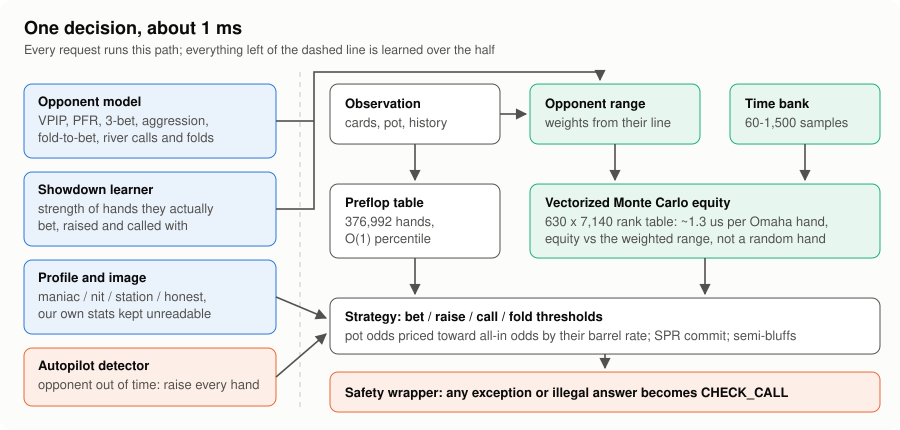
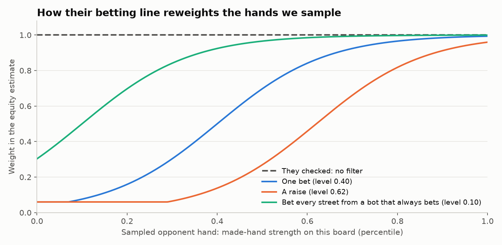
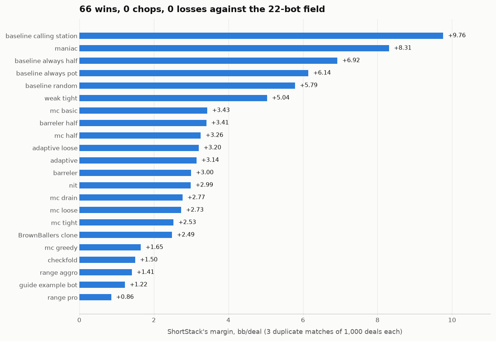
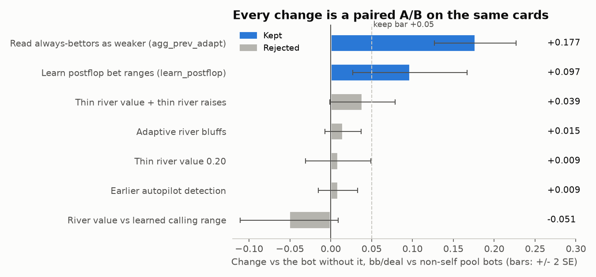

# ShortStack

**Heads-up Short Deck 5-card Pot-Limit Omaha bot for the TAMU Datathon Poker Bot Challenge.**

- Starter bundle: [tamu-datathon-org/heads-up-bundle](https://github.com/tamu-datathon-org/heads-up-bundle)
- Participant guide: [docs/starter-guide.md](docs/starter-guide.md)

ShortStack plays 1,000-deal duplicate matches against every other team's bot. It scores hands with a vectorized numpy evaluator, takes Monte Carlo equity against the opponent's *range* (weighted by their betting line) instead of a random hand, and adapts to each opponent within the half: it learns their ranges from showdowns, shifts its play against maniacs, nits and calling stations, and steals every hand from bots whose time bank has run out.

- **Team:** Vignesh Nagarajan, Srivanth Rudrangi, Aaron Jacob, Anish Koduri
- **Stack:** Python, numpy, FastAPI (organizer plumbing, unchanged)
- **Run it:** `pip install -r requirements-dev.txt`, then `python -m pytest -q`; see [EXTENDED.md](EXTENDED.md) for matches, the league and the build check

## How it works

Most of the field will compute equity with `omaha_score`, which costs about **15 µs** per hand, so naive simulation drains the **8 s** time bank and the judge then plays check-or-fold for them. ShortStack precomputes a **630 x 7140** rank table and scores its own hand against every board once per hand, so a 1,000-sample Monte Carlo call takes about **1.3 ms** on the flop and turn and **0.36 ms** on the river. Preflop decisions read a table of equity vs a random hand for all **376,992** starting hands. Postflop, sampled opponent hands are weighted by their preflop percentile and by how strong their made hand must be to explain their bets, so a pot-sized bet isn't treated like a random hand. Those levels are learned too: they move toward each opponent's bet frequency and the hands it shows down on each street, and a bot that bets every street is read as betting its whole range. On the river it bluffs when an opponent's measured fold rate to that bet size pays for it, and against bots that bet into it often it calls wider while its own fold rate stays above **55%**. Calls are priced between the pot odds and the all-in odds, depending on how often the opponent keeps betting. After **10** default actions in a row (including **4** folds), it raises every hand. Its own logic spends at most **45%** of the time bank, and a timing probe at the start of each half scales that down on a slower machine (it no longer runs out even 4x slower), and every answer is checked for legality, so it can't forfeit on errors.

Against an opponent pool built to look like the expected field (organizer baselines, the guide's example bot, MC-equity threshold bots, a clone of the rival bot BrownBallers, fast range-aware bots, bluff-heavy barrelers, adaptive exploiters and self-play variants), the bot went **66-0-0** against the 22 non-self bots on three seeds, at **+3.71 bb/deal** (68-25-3 including self-play, where most matches are chops). It beat the real BrownBallers code in **3 of 3** matches (+2.80 to +2.90 bb/deal). In tournament-style Docker matches (each half in fresh containers limited to 1 CPU, [tools/container_match.sh](tools/container_match.sh)) against Drew's sdplo bot, a Bayesian-range EV maximiser that kept its whole time bank, it went **2-6-0** against its v4 and v5, with every margin zero or positive (mean **+0.32 bb/deal**). It used **5.3-5.9 s** of the 8 s bank in the containers and about **4.8 s** on a laptop, with **0 errors**. Every change is A/B tested on paired seeds before it is kept; see [docs/experiments.md](docs/experiments.md).

The pool is our model of other teams, not the real field, so margins against actual submissions will differ. Drew's bot is the hardest opponent we know of: at 1 CPU those matches are mostly chops, and given 3x the thinking time (simulated) it beats ShortStack by about **1 bb/deal**, so a faster tournament machine would favour it. Timing was measured on a laptop; the tournament machine may be slower, which the time bank absorbs by sampling less.
