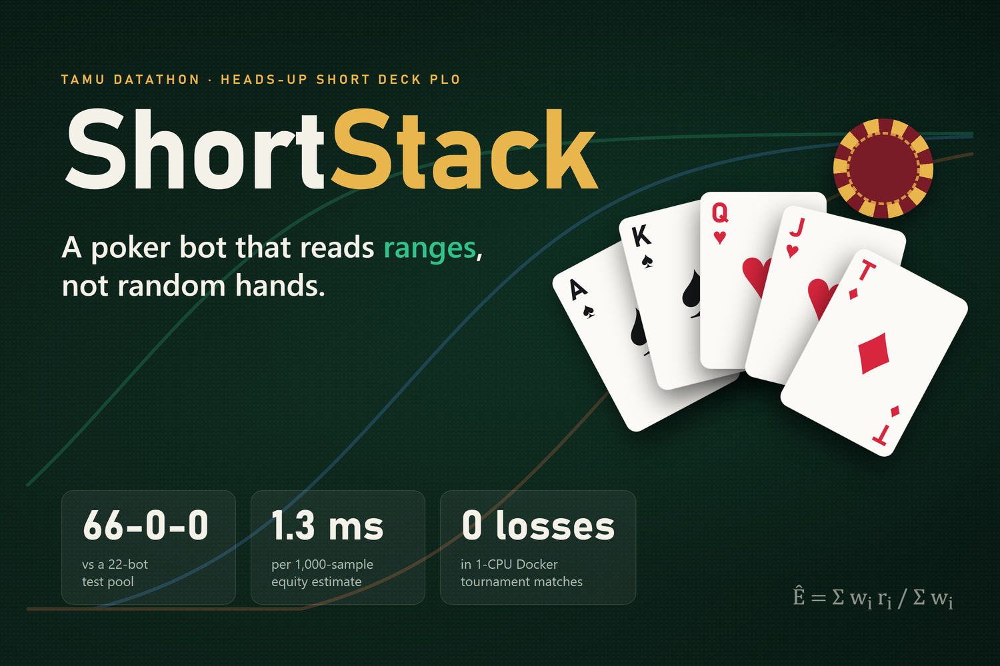
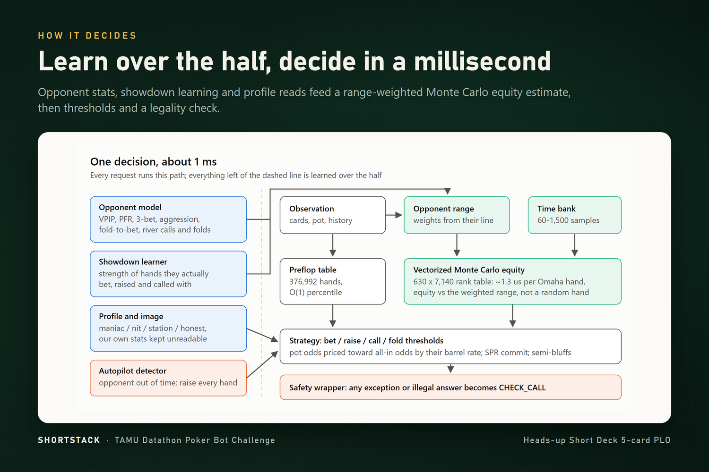
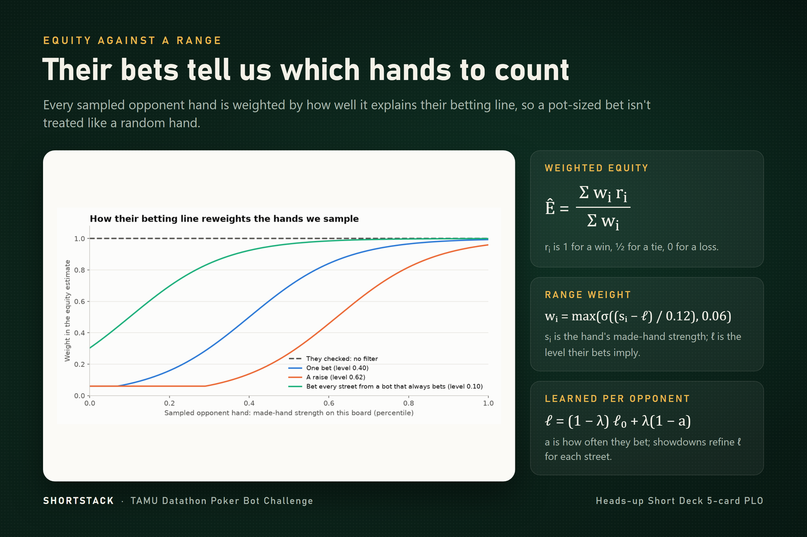
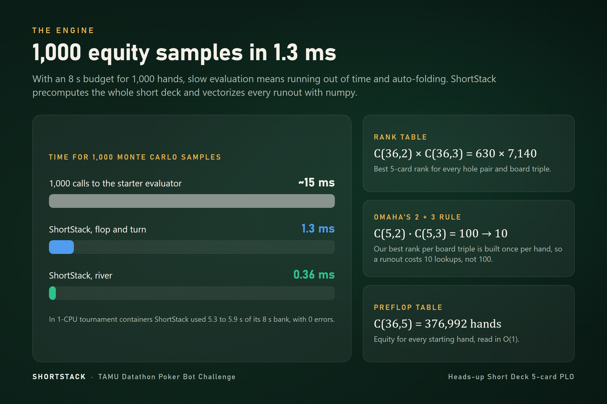
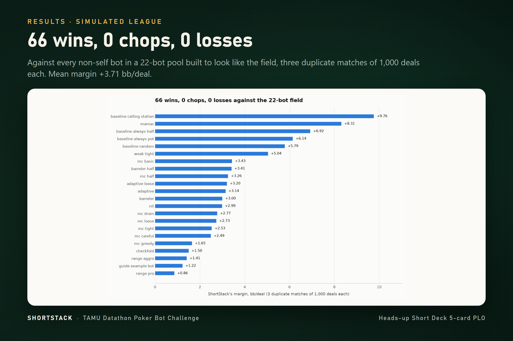
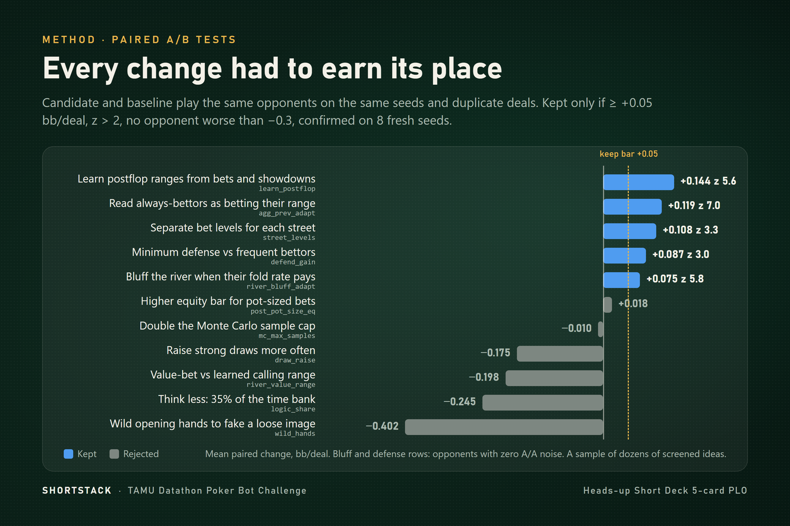
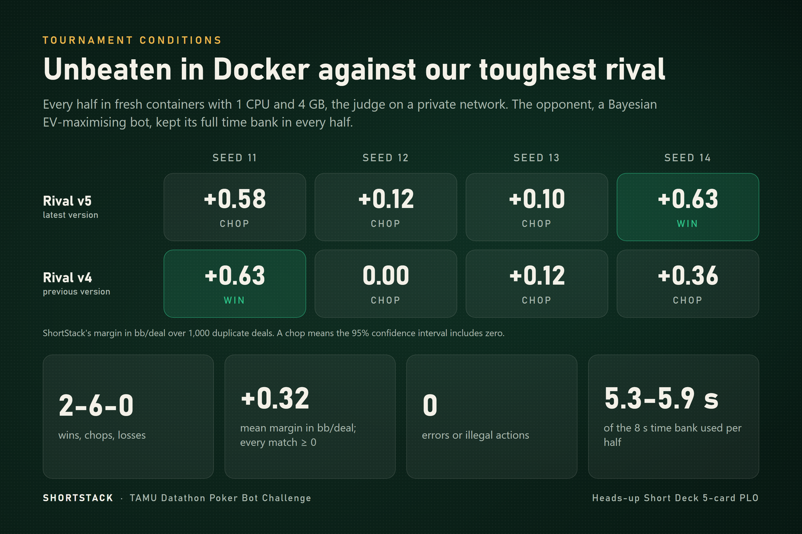

# ShortStack

**Heads-up Short Deck 5-card Pot-Limit Omaha bot for the TAMU Datathon Poker Bot Challenge.**

🏆 **TAMU Datathon 2026 winner: Rev's Casino award.**

- Starter bundle: [tamu-datathon-org/heads-up-bundle](https://github.com/tamu-datathon-org/heads-up-bundle)
- Participant guide: [docs/starter-guide.md](docs/starter-guide.md)

ShortStack plays 1,000-deal duplicate matches against every other team's bot. It scores hands with a vectorized numpy evaluator, takes Monte Carlo equity against the opponent's *range* (weighted by their betting line) instead of a random hand, and adapts to each opponent within the half: it learns their ranges from showdowns, shifts its play against maniacs, nits and calling stations, and steals every hand from bots whose time bank has run out.

- **Team:** Vignesh Nagarajan, Srivanth Rudrangi, Aaron Jacob, Anish Koduri
- **Stack:** Python, numpy, FastAPI (organizer plumbing, unchanged)
- **Run it:** `pip install -r requirements-dev.txt`, then `python -m pytest -q`; see [EXTENDED.md](EXTENDED.md) for matches, the league and the build check

<table>
  <tr>
    <td colspan="2" align="center"></td>
  </tr>
  <tr>
    <td width="50%"></td>
    <td width="50%"></td>
  </tr>
  <tr>
    <td width="50%"></td>
    <td width="50%"></td>
  </tr>
  <tr>
    <td width="50%"></td>
    <td width="50%"></td>
  </tr>
</table>

## How it works

Most of the field will compute equity with `omaha_score`, which costs about **15 µs** per hand, so naive simulation drains the **8 s** time bank and the judge then plays check-or-fold for them. ShortStack precomputes a **630 x 7140** rank table and scores its own hand against every board once per hand, so a 1,000-sample Monte Carlo call takes about **1.3 ms** on the flop and turn and **0.36 ms** on the river. Preflop decisions read a table of equity vs a random hand for all **376,992** starting hands. It pot-raises the small blind with the top 60% of hands. Postflop, sampled opponent hands are weighted by their preflop percentile and by every action they took this hand, each read through how often that opponent takes it in that exact spot: a bet made 40% of the time means roughly their top 40%, so a bot that bets 98% of flops tells us almost nothing by betting. On the river it bluffs when an opponent's measured fold rate to that bet size pays for it, and against bots that bet into it often it calls wider while its own fold rate stays above **55%**. Calls are priced between the pot odds and the all-in odds, depending on how often the opponent keeps betting. After **10** default actions in a row (including **4** folds), it raises every hand. Its own logic spends at most **45%** of the time bank, and a timing probe at the start of each half scales that down on a slower machine (it no longer runs out even 4x slower), and every answer is checked for legality, so it can't forfeit on errors.

Against an opponent pool built to look like the expected field (organizer baselines, the guide's example bot, MC-equity threshold bots, fast range-aware bots, bluff-heavy barrelers, adaptive exploiters and self-play variants), the bot went **65-1-0** against the 22 non-self bots on three seeds (real clock, Linux). In tournament-style Docker matches (each half in fresh containers limited to 1 CPU, [tools/container_match.sh](tools/container_match.sh)) against three other teams' bots on seeds 11-18, it went **11-5-0** against Drew's sdplo v4 and v5 (+0.78 and +0.71 bb/deal), and lost to the two strongest bots we have seen, CsaBest's PLO5-MCCFR (**-0.54 to -0.61**) and quad-j's jish_4 (**-0.87 to -1.06**), down from -0.90 and -1.95 before the November 8 changes. It used **5.8-6.3 s** of the 8 s bank in the containers, with **0 errors**. Every change is A/B tested on paired seeds before it is kept, and the ones that touch the strongest opponents are confirmed in Docker; see [docs/experiments.md](docs/experiments.md).

The pool is our model of other teams, not the real field, so margins against actual submissions will differ. PLO5-MCCFR (an MCCFR blueprint) and jish_4 (an equity bot that reads every action by its spot frequency) still beat ShortStack. Timing was measured on a laptop; the tournament machine may be slower, which the time bank absorbs by sampling less.
